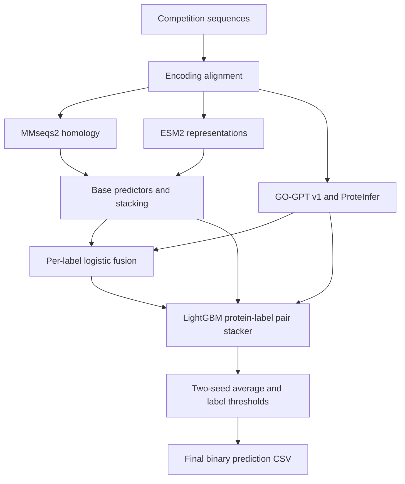

# Protein Function Prediction

Predict 500 anonymous Gene Ontology (GO) function labels from protein sequences using homology retrieval, protein language models, annotation-pretrained models, and a multilayer ensemble.

**Final release: V5.0.0 · Highest reported leaderboard score: 64.3818**

The final submission is [`pairgogpt_v2_allkbag2.csv`](https://github.com/Cooljoes/protein-function-prediction-submission/releases/download/v5.0.0/pairgogpt_v2_allkbag2.csv), covering 28,450 proteins and 500 binary labels. The score uses the report's Macro-F1 × 100 convention, equivalent to 0.643818 on a 0–1 scale. The project owner confirmed this file and its score for this release on 2026-10-17.

[Download V5.0.0](https://github.com/Cooljoes/protein-function-prediction-submission/releases/tag/v5.0.0) · [Analysis report](https://github.com/Cooljoes/protein-function-prediction-submission/releases/download/v5.0.0/protein_function_prediction_report.docx) · [Source archive](https://github.com/Cooljoes/protein-function-prediction-submission/releases/download/v5.0.0/protein_function_prediction_source.zip)

## Task and data

| Item | Description |
|---|---|
| Training set | 113,796 labeled proteins |
| Test set | 28,450 proteins |
| Targets | 500 anonymous GO-related binary labels |
| Input | Protein sequences using the competition's nonstandard letter encoding |
| Metric | Macro-F1: the unweighted mean of F1 across the 500 labels |
| Submission | `protein_id`, followed by `label_0` through `label_499`; predictions are `0` or `1` |

The report describes a sparse, imbalanced task: the training label matrix has about 5.08% positive entries and an average of 25.42 labels per protein. Sequence length, homology coverage, label correlations, and annotation-depth variation guide the feature design.

## Method

1. **Align sequence encoding.** Infer the letter-to-amino-acid mapping from within-training-set alignment statistics and BLOSUM62. Feed the mapped sequences to pretrained models.
2. **Build complementary predictors.** Combine MMseqs2 homology transfer within the competition training set, k-mer ridge regression, ESM2-650M embeddings with kNN and neural heads, and annotation features from GO-GPT v1 and four ProteInfer checkpoints.
3. **Stack the base models.** Combine 11 base predictors through a LightGBM protein–label pair model and an MLP stacker, then blend their predictions at 2:1.
4. **Fuse annotation signals per label.** Logistic regression combines the base logit, selected GO-GPT and ProteInfer terms, homology interactions, and generated-term counts. Term selection uses correlation within the training folds.
5. **Learn cross-label corrections.** A LightGBM pair stacker uses the fusion logit as its initial score and learns corrections from model logits, direct annotation features, protein-level prediction shape, related labels, inferred label hierarchy, and homology statistics.
6. **Average seeds and apply thresholds.** The final `allkbag2` variant averages two seeds and adds GO-GPT score-space kNN to the 15 predictor inputs used by the preceding `allbag2` variant. Each label has its own decision threshold.

The `v2` in `pairgogpt_v2_*` is a local pipeline iteration name. The archived workflow uses the pretrained **GO-GPT v1** model.

## Results and development history

The local results below come from the analysis report and the source archive's `reports/cv_log.csv`. Values are **Macro-F1 × 100**; dev, clean, and leaderboard evaluations are different measurements.

| Development stage | Dev | Clean |
|---|---:|---:|
| Base ensemble `blend_sm` | 47.69 | 47.59 |
| Add GO-GPT per-label fusion | 53.93 | 53.83 |
| Add ProteInfer per-label features | 56.02 | 55.94 |
| Pair stacker `pairgogpt_v2_pi` | 60.39 | 60.32 |
| Direct ProteInfer features, four checkpoints, ridge and shape features `pid4rs` | 62.29 | 62.24 |
| Preceding two-seed ensemble `allbag2` | 62.724 | 62.679 |
| Final supplied two-seed ensemble `allkbag2` | 62.761 | 62.720 |

The previous PairGO submission recorded **62.1406** on the leaderboard. The final supplied CSV is recorded at **64.3818**, an increase of **2.2412 points**. Exact leaderboard scores are supplied by the project owner; this publication did not perform a new leaderboard query.

**Artifact history:** the original report and source archive describe `allbag2` as their final submission and associate it with the earlier recorded 64.38/64.3818 result. Their bundled CSV differs from `allkbag2`. For V5.0.0, the owner explicitly selected the separately supplied `allkbag2` file and confirmed 64.3818 as its score. Use the standalone V5 CSV and its checksum for the current final artifact; the report and source archive are preserved as historical materials.

## Evaluation protocol

- Five folds keep identical sequences together. This groups exact sequences, rather than homology clusters.
- The report calls threshold evaluation “honest”: thresholds for a fold are tuned using the other folds.
- Dev contains 108,796 training proteins. Clean contains 100,504 after excluding 8,292 proteins used for candidate GO-term selection.
- A separate 5,000-protein confirmation set was used at two earlier model milestones. No confirmation-set score is reported for the final `allkbag2` variant.
- The report identifies fully nested cross-fitting across ensemble layers as future work. Local selection results should be read with that limitation.

The report's findings include strong gains from annotation-pretrained models and cross-label context, alongside annotation differences among identical sequences. The reported training workflow uses competition data and downloaded pretrained weights; it does not provide an independent audit of those weights' original training-data overlap.

## Files and reproduction

| V5 asset | Contents |
|---|---|
| `pairgogpt_v2_allkbag2.csv` | Owner-confirmed final submission |
| `protein_function_prediction_report.docx` | Original Chinese analysis report, unchanged |
| `protein_function_prediction_source.zip` | Original `release(1).zip`, unchanged; source scripts, model-resource manifest, development logs, and historical `allbag2` CSV |
| `V5_manifest.json` | File hashes, CSV checks, score provenance, and artifact-version notes |
| `SHA256SUMS.txt` | Download integrity checks |

The source archive expands to `release/`. Start with its `README.md`, `MODELS.md`, and `requirements.txt`. The documented environment is Windows 11, Python 3.12, an RTX 4060 Laptop GPU with 8 GB VRAM, and 16 GB RAM. Competition `train.csv`, `test.csv`, and `submit_template_v1.csv`, pretrained weights, and large feature caches must be obtained or generated separately.

| Stage | Main scripts in `release/src/` |
|---|---|
| Fold assignment and encoding map | `02_make_folds.py`, `13_encoding_map.py` |
| Base predictors | `03_baseline_kmer.py`, `04_embed.py`, `05_train_mlp.py`, `06_knn.py`, `07_mmseqs_knn.py`, `17_train_mlp_cond.py` |
| Base stacking | `21_depth.py`, `09_stack.py`, `23_mlp_stack.py`, `08_blend.py` |
| GO-GPT features | `20_gogpt.py`, `26_camber_prep.py`, `27_gogpt_merge.py` |
| ProteInfer features | `33_proteinfer.py`, `34_proteinfer_terms.py`, `40_pinf_ridge.py` |
| Fusion, pair stacking, seed averaging, export | `28_gogpt_fusion.py`, `35_pair_gogpt.py`, `41_avg.py`, `38_make_sub.py` |

The included command sequence reproduces the **earlier `allbag2` workflow**. Although its logs include `allkbag2`, the archive does not include the additional `gogptq` feature-generation step required for complete reproduction of that variant. The published final CSV is therefore the authoritative downloadable result; the source archive is a reference implementation with this documented gap. Training was not rerun during publication. Third-party model sources, revisions, checksums, and licenses are listed in `MODELS.md` and the bundled upstream license files.

## Release history

Release numbers follow publication milestones and are separate from model-family names such as V25, V36, and PairGO.

| Release | Artifact or experiment | Recorded result |
|---|---|---|
| [V5.0.0](https://github.com/Cooljoes/protein-function-prediction-submission/releases/tag/v5.0.0) | Final `pairgogpt_v2_allkbag2.csv`, report, and source archive | Leaderboard 64.3818 |
| [V4.0.0](https://github.com/Cooljoes/protein-function-prediction-submission/releases/tag/v4.0.0) | PairGO `pairgogpt_v2_pi.csv` | Leaderboard 62.1406 |
| [V3.0.0](https://github.com/Cooljoes/protein-function-prediction-submission/releases/tag/v3.0.0) | V36 controlled GO-feature pilot | Pilot CV 38.7896; promotion gate not passed |
| [V2.0.0](https://github.com/Cooljoes/protein-function-prediction-submission/releases/tag/v2.0.0) | V25 + GO + V30 Pro evaluation artifacts | Historical selection 48.6082; no test CSV |
| [V1.0.0](https://github.com/Cooljoes/protein-function-prediction-submission/releases/tag/v1.0.0) | V25 + GO prediction CSV | Historical selection 48.1454 |

This table displays scores on a 0–100 scale; earlier release titles may use the 0–1 scale. V1–V3 used different local protocols and should not be directly ranked against PairGO leaderboard results. PairGO's `pi` and `allkbag2` files belong to the workflow described in the supplied report; they are distinct from the separate V41 fusion experiment.

---

# 蛋白质功能预测

本项目根据蛋白质序列预测 500 个匿名 GO 功能标签，融合训练集内部的同源检索、蛋白质语言模型、功能注释预训练模型与多层集成学习。

**最终版本：V5.0.0 · 报告最高排行榜得分：64.3818**

最终文件为 [`pairgogpt_v2_allkbag2.csv`](https://github.com/Cooljoes/protein-function-prediction-submission/releases/download/v5.0.0/pairgogpt_v2_allkbag2.csv)，包含 28,450 条蛋白质记录和 500 个二元标签。按报告采用的 Macro-F1 × 100 口径，64.3818 对应 0–1 标度的 0.643818。项目所有者于 2026-10-17 明确确认了本次发布的文件及其成绩。

[下载 V5.0.0](https://github.com/Cooljoes/protein-function-prediction-submission/releases/tag/v5.0.0) · [数智分析报告](https://github.com/Cooljoes/protein-function-prediction-submission/releases/download/v5.0.0/protein_function_prediction_report.docx) · [源码资料包](https://github.com/Cooljoes/protein-function-prediction-submission/releases/download/v5.0.0/protein_function_prediction_source.zip)

## 任务与数据

| 项目 | 说明 |
|---|---|
| 训练集 | 113,796 条带标签蛋白质记录 |
| 测试集 | 28,450 条蛋白质记录 |
| 预测目标 | 500 个匿名 GO 相关标签 |
| 输入 | 使用比赛非标准字母编码的蛋白质序列 |
| 评价指标 | 对 500 个标签分别计算 F1 后取算术平均，即 Macro-F1 |
| 提交格式 | `protein_id` 加 `label_0` 至 `label_499`，标签值为 `0` 或 `1` |

报告记录的标签矩阵阳性比例约为 5.08%，每条蛋白质平均有 25.42 个标签。标签稀疏且分布不均，因此方案同时关注序列表示、同源覆盖、标签关联与注释深度差异。

## 技术方案

1. <strong>序列编码对齐。</strong> 根据训练集内部比对统计与 BLOSUM62 推断字母到标准氨基酸的映射，再输入预训练模型。
2. <strong>构建多种预测来源。</strong> 使用训练集内部 MMseqs2 同源迁移、k-mer 岭回归、ESM2-650M 嵌入及其 kNN/神经网络分类头，并提取 GO-GPT v1 与四个 ProteInfer 模型的功能注释特征。
3. <strong>形成基础集成层。</strong> 将 11 个基础预测器输入 LightGBM 配对堆叠与 MLP 堆叠，再按 2:1 融合。
4. <strong>逐标签融合。</strong> 逻辑回归结合基础层 logit、折内筛选的 GO-GPT/ProteInfer 术语、同源交互和生成术语数量。
5. <strong>学习跨标签修正。</strong> LightGBM 以“蛋白质 × 标签”为样本，以融合 logit 为初始分数，利用模型输出、注释特征、预测形状、相关标签及标签层级等信息进行修正。
6. <strong>双种子平均与逐标签决策。</strong> `allkbag2` 在此前 `allbag2` 的 15 项预测输入上加入 GO-GPT 分数空间 kNN，平均两个种子的结果，再应用各标签的阈值。

文件名 `pairgogpt_v2_*` 中的 `v2` 表示本地流程迭代；归档方案实际使用的预训练模型为 GO-GPT v1。

## 创作历程与结果

以下本地结果来自分析报告及源码包 `reports/cv_log.csv`，统一采用 Macro-F1 × 100。dev、clean 和排行榜对应不同的评估数据。

| 迭代阶段 | dev | clean |
|---|---:|---:|
| 基础集成 `blend_sm` | 47.69 | 47.59 |
| 加入 GO-GPT 逐标签融合 | 53.93 | 53.83 |
| 加入 ProteInfer 特征 | 56.02 | 55.94 |
| 配对堆叠 `pairgogpt_v2_pi` | 60.39 | 60.32 |
| 四个 ProteInfer 模型、直接 logit、岭回归与预测形状 `pid4rs` | 62.29 | 62.24 |
| 较早的双种子集成 `allbag2` | 62.724 | 62.679 |
| 本次提供的最终双种子集成 `allkbag2` | 62.761 | 62.720 |

此前 PairGO 版本的排行榜得分为 62.1406；本次最终文件记录为 64.3818，提高 2.2412 分。排行榜精确成绩由项目所有者提供，本次发布没有重新查询比赛平台。

<strong>文件沿革说明。</strong> 原报告及源码包曾将 `allbag2` 记作最终提交，并关联当时记录的 64.38/64.3818；包内 CSV 与本次 `allkbag2` 的预测内容不同。发布 V5.0.0 时，项目所有者明确选择单独提供的 `allkbag2`，并确认其成绩为 64.3818。当前最终结果以 V5 单独提供的 CSV 及校验值为准，原报告和源码包作为历史资料保留。

## 评估方式与结果边界

- 五折划分将完全相同的序列放在同一折；它不是按同源簇划分。
- 报告中的 honest 口径指每折阈值仅用其余折调优，再用于当前折计分。
- dev 包含 108,796 条训练记录；clean 再排除用于候选 GO 术语筛选的 8,292 条记录，共 100,504 条。
- 另有 5,000 条确认集记录，在此前两个关键阶段使用。最终 `allkbag2` 没有报告确认集成绩。
- 报告将各集成层之间的完整嵌套交叉拟合列为后续改进方向，应据此理解本地选模成绩。

报告发现，功能注释预训练模型与跨标签上下文带来了主要增益，而相同序列之间的标签差异体现了注释深度变化。报告描述的训练流程使用比赛数据和公开预训练权重；这些权重原始训练数据的重叠情况未经过独立审计。

## 下载内容与复现

| V5 附件 | 内容 |
|---|---|
| `pairgogpt_v2_allkbag2.csv` | 项目所有者确认的最终预测文件 |
| `protein_function_prediction_report.docx` | 原始中文数智分析报告 |
| `protein_function_prediction_source.zip` | 原 `release(1).zip`，包含源码、模型资源清单、开发日志和历史 `allbag2` CSV |
| `V5_manifest.json` | 文件哈希、CSV 检查、成绩来源与版本对应说明 |
| `SHA256SUMS.txt` | 下载文件完整性校验值 |

源码包解压后目录为 `release/`。先阅读其中的 `README.md`、`MODELS.md` 与 `requirements.txt`。记录的开发环境为 Windows 11、Python 3.12、RTX 4060 Laptop 8 GB 显卡及 16 GB 内存。比赛原始数据、预训练权重和大型中间特征需要另行获取或生成。

主要流程依次包括折划分与编码映射、基础模型、GO-GPT/ProteInfer 特征、逐标签融合、配对堆叠、种子平均及 CSV 导出。对应脚本包括 `02_make_folds.py`、`13_encoding_map.py`、`20_gogpt.py`、`33_proteinfer.py`、`28_gogpt_fusion.py`、`35_pair_gogpt.py`、`41_avg.py` 和 `38_make_sub.py`，完整命令见包内说明。

包内命令针对较早的 `allbag2` 流程。虽然日志包含 `allkbag2` 的评估结果，但未收录其新增 `gogptq` 特征的生成步骤，因此该源码包不能单独保证完整复现本次最终 CSV。最终预测以发布附件为准；本次发布未重新训练模型。第三方资源的来源、版本、校验值和许可列于 `MODELS.md` 及上游许可文件。

## 发布版本

| 版本 | 内容 | 记录结果 |
|---|---|---|
| [V5.0.0](https://github.com/Cooljoes/protein-function-prediction-submission/releases/tag/v5.0.0) | 最终 `allkbag2` CSV、报告及源码包 | 排行榜 64.3818 |
| [V4.0.0](https://github.com/Cooljoes/protein-function-prediction-submission/releases/tag/v4.0.0) | PairGO `pi` CSV | 排行榜 62.1406 |
| [V3.0.0](https://github.com/Cooljoes/protein-function-prediction-submission/releases/tag/v3.0.0) | V36 受控 GO 特征试验 | pilot CV 38.7896，未达到晋级门槛 |
| [V2.0.0](https://github.com/Cooljoes/protein-function-prediction-submission/releases/tag/v2.0.0) | V25 + GO + V30 Pro 评估资料 | 历史 selection 48.6082，没有测试 CSV |
| [V1.0.0](https://github.com/Cooljoes/protein-function-prediction-submission/releases/tag/v1.0.0) | V25 + GO 预测 CSV | 历史 selection 48.1454 |

表中统一使用 0–100 标度，早期 Release 标题可能保留 0–1 标度。V1–V3 的本地评估口径与 PairGO 排行榜不同，不应直接排名比较。Release 编号与 V25、V36 等模型名称独立；报告中的 PairGO `pi`、`allkbag2` 文件也与另外开展的 V41 融合实验区分。
