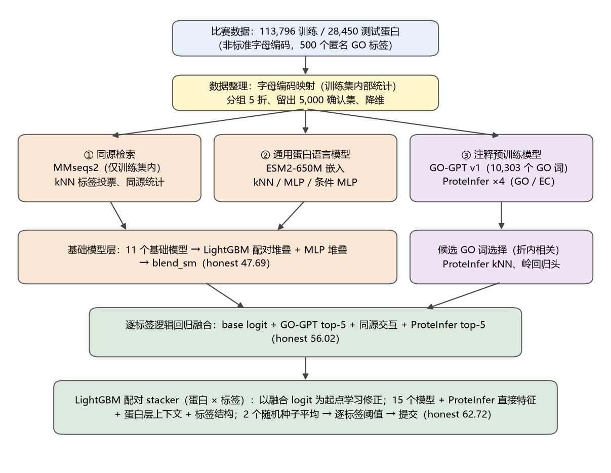

# Report Figure Gallery

[Report guide](README.md) · [Tables](tables.md) · [Project overview](../README.md)

All 10 figures are extracted from the original DOCX at their embedded resolution. Click a figure to open the full image.

The original report describes the historical `allbag2` workflow. The current [V5.0.0 release](https://github.com/Cooljoes/protein-function-prediction-submission/releases/tag/v5.0.0) uses the separately supplied `allkbag2` CSV, with the owner-confirmed leaderboard score **64.3818**. Original figure labels and table values are retained.

全部 10 张图均从 DOCX 按原始分辨率提取，点击图片可打开原图。

原报告描述历史 `allbag2` 方案；当前 [V5.0.0](https://github.com/Cooljoes/protein-function-prediction-submission/releases/tag/v5.0.0) 使用单独提供的 `allkbag2`，项目所有者确认的排行榜成绩为 **64.3818**。原图标注与表格数值保持原样。

| Figure | Title | Original caption | Report chapter |
|---|---|---|---|
| [1](#figure-01) | Overall Modeling Workflow | 图 1  总体技术路线 | [3 分析方案的设计](report/03-analysis-design.md) |
| [2](#figure-02) | Sequence Length Distributions in the Training and Test Sets | 图 2  训练集与测试集的序列长度分布 | [6 数据的探索性分析](report/06-exploratory-analysis.md) |
| [3](#figure-03) | Residue Frequencies in Competition Encoding and Mapped Amino Acids | 图 3  字母频率：竞赛编码（左）与对应的标准氨基酸（右） | [6 数据的探索性分析](report/06-exploratory-analysis.md) |
| [4](#figure-04) | Distribution of Labels per Protein | 图 4  每个蛋白的标签数分布 | [6 数据的探索性分析](report/06-exploratory-analysis.md) |
| [5](#figure-05) | Positive Rates of the 500 Labels | 图 5  500 个标签的阳性率（长尾分布） | [6 数据的探索性分析](report/06-exploratory-analysis.md) |
| [6](#figure-06) | Correlations Among the 40 Most Frequent Labels | 图 6  出现最频繁的 40 个标签之间的相关系数 | [6 数据的探索性分析](report/06-exploratory-analysis.md) |
| [7](#figure-07) | Distribution of Best Homology Hit Identity | 图 7  最佳同源命中一致度分布 | [6 数据的探索性分析](report/06-exploratory-analysis.md) |
| [8](#figure-08) | Honest Macro-F1 Across Model Development Stages | 图 8  模型逐步演进的 honest Macro-F1 | [7 分析模型的构建与评估](report/07-modeling-and-evaluation.md) |
| [9](#figure-09) | Mean Label F1 by Label Prevalence Group | 图 9  按标签阳性率分组的平均 F1 | [7 分析模型的构建与评估](report/07-modeling-and-evaluation.md) |
| [10](#figure-10) | Mean Per-Protein F1 by Best Homology Hit Identity | 图 10  按最佳同源命中一致度分组的每蛋白平均 F1 | [7 分析模型的构建与评估](report/07-modeling-and-evaluation.md) |

## Figure 1 — Overall Modeling Workflow

*图 1  总体技术路线*

Historical workflow: 15 prediction inputs and local Macro-F1 62.72; the V5 `allkbag2` variant adds a GO-GPT score-space kNN input.

历史流程包含 15 项预测输入，本地 Macro-F1 为 62.72；V5 的 `allkbag2` 增加了 GO-GPT 分数空间 kNN 输入。

[Read in context / 阅读原章节](report/03-analysis-design.md) · [Back to top / 返回顶部](#report-figure-gallery)

## Figure 2 — Sequence Length Distributions in the Training and Test Sets

*图 2  训练集与测试集的序列长度分布*

[Read in context / 阅读原章节](report/06-exploratory-analysis.md) · [Back to top / 返回顶部](#report-figure-gallery)

## Figure 3 — Residue Frequencies in Competition Encoding and Mapped Amino Acids

*图 3  字母频率：竞赛编码（左）与对应的标准氨基酸（右）*

[Read in context / 阅读原章节](report/06-exploratory-analysis.md) · [Back to top / 返回顶部](#report-figure-gallery)

## Figure 4 — Distribution of Labels per Protein

*图 4  每个蛋白的标签数分布*

[Read in context / 阅读原章节](report/06-exploratory-analysis.md) · [Back to top / 返回顶部](#report-figure-gallery)

## Figure 5 — Positive Rates of the 500 Labels

*图 5  500 个标签的阳性率（长尾分布）*

[Read in context / 阅读原章节](report/06-exploratory-analysis.md) · [Back to top / 返回顶部](#report-figure-gallery)

## Figure 6 — Correlations Among the 40 Most Frequent Labels

*图 6  出现最频繁的 40 个标签之间的相关系数*

[Read in context / 阅读原章节](report/06-exploratory-analysis.md) · [Back to top / 返回顶部](#report-figure-gallery)

## Figure 7 — Distribution of Best Homology Hit Identity

*图 7  最佳同源命中一致度分布*

[Read in context / 阅读原章节](report/06-exploratory-analysis.md) · [Back to top / 返回顶部](#report-figure-gallery)

## Figure 8 — Honest Macro-F1 Across Model Development Stages

*图 8  模型逐步演进的 honest Macro-F1*

The final model shown here is the report's `allbag2`.

图中的最终模型为报告原始的 `allbag2`。

[Read in context / 阅读原章节](report/07-modeling-and-evaluation.md) · [Back to top / 返回顶部](#report-figure-gallery)

## Figure 9 — Mean Label F1 by Label Prevalence Group

*图 9  按标签阳性率分组的平均 F1*

The final model shown here is the report's `allbag2`.

图中的最终模型为报告原始的 `allbag2`。

Metric: mean label F1 within each prevalence group.

指标：各阳性率分组内的平均标签 F1。

[Read in context / 阅读原章节](report/07-modeling-and-evaluation.md) · [Back to top / 返回顶部](#report-figure-gallery)

## Figure 10 — Mean Per-Protein F1 by Best Homology Hit Identity

*图 10  按最佳同源命中一致度分组的每蛋白平均 F1*

The final model shown here is the report's `allbag2`.

图中的最终模型为报告原始的 `allbag2`。

Metric: mean **per-protein** F1 within each homology group; this differs from label-wise Macro-F1.

指标：各同源区间内的平均**每蛋白 F1**，与逐标签 Macro-F1 不同。

[Read in context / 阅读原章节](report/07-modeling-and-evaluation.md) · [Back to top / 返回顶部](#report-figure-gallery)

## Source

[Original DOCX](https://github.com/Cooljoes/protein-function-prediction-submission/releases/download/v5.0.0/protein_function_prediction_report.docx) · [Image provenance and SHA-256](../assets/figures/report/manifest.json)
