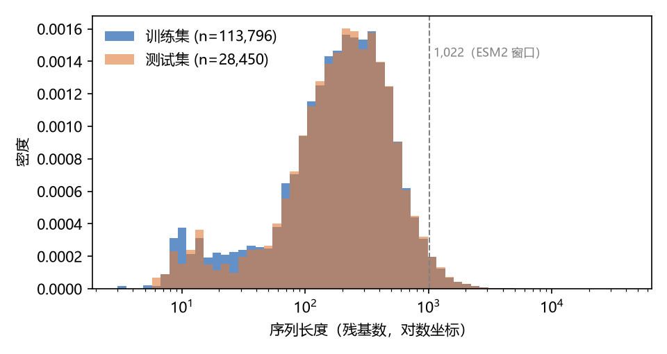
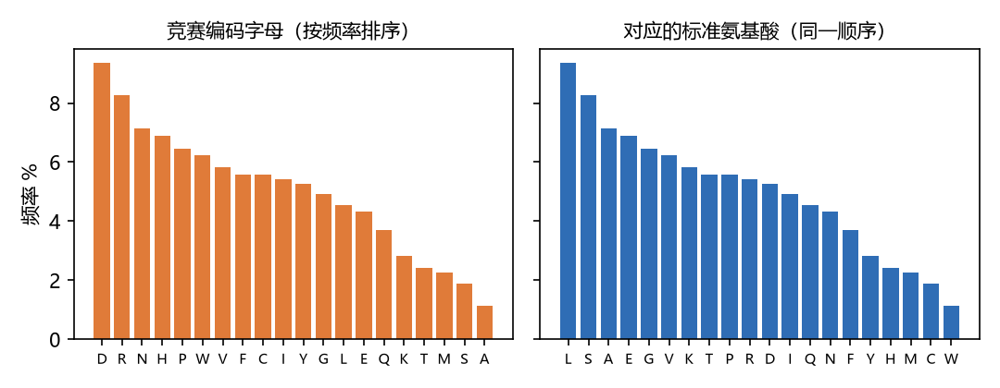
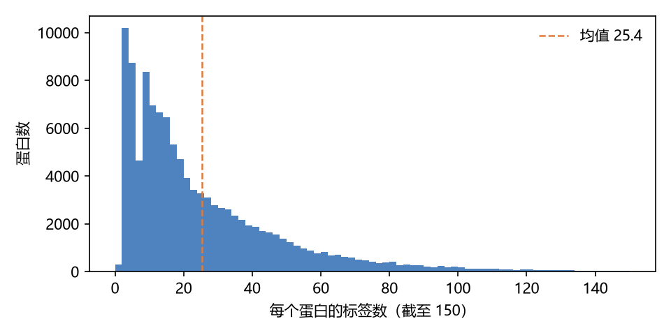
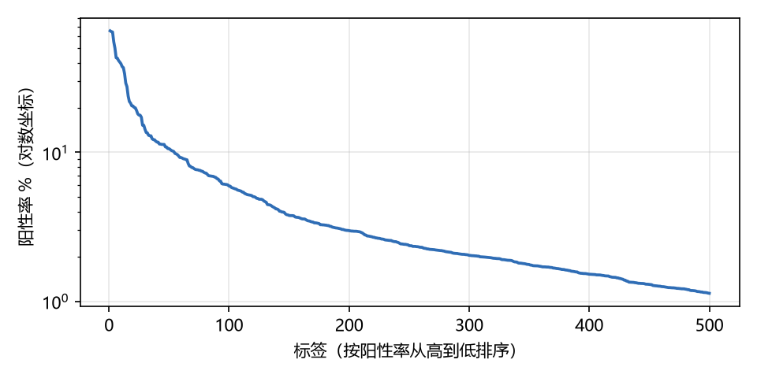
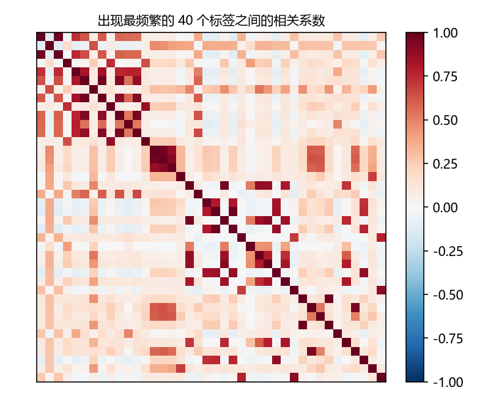
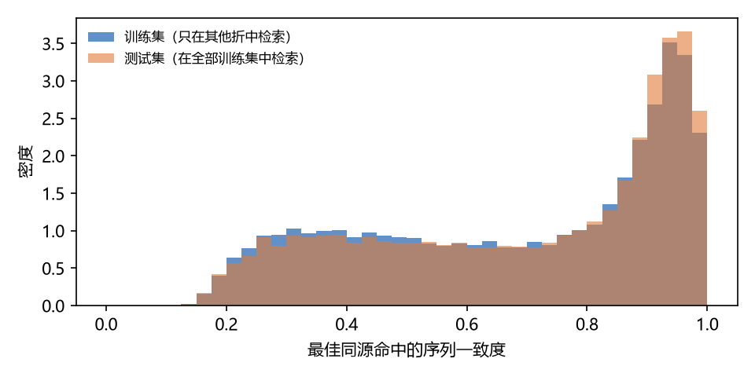

# Exploratory Data Analysis

[Report guide](../README.md) · [Figures](../figures.md) · [Tables](../tables.md)

This chapter examines sequence lengths, residue frequencies, label counts, label imbalance, label correlations, and homology coverage. It also reports differences in annotations between proteins with identical sequences, highlighting variability that a sequence-only model may not explain.

Original report section: **6 数据的探索性分析**. [Download the source DOCX](https://github.com/Cooljoes/protein-function-prediction-submission/releases/download/v5.0.0/protein_function_prediction_report.docx).

## 6 数据的探索性分析

### 6.1 描述统计

**表 4  数据描述统计**

| 指标 | 训练集 | 测试集 |
| --- | --- | --- |
| 蛋白数 | 113,796 | 28,450 |
| 序列长度：最小 / 中位数 / 均值 / 最大 | 3 / 410 / 553.2 / 35,375 | 6 / 414 / 555.4 / 35,213 |
| 长度 &gt; 1,022 的比例 | 10.7% | — |
| 每个蛋白的标签数：均值 / 中位数 / 范围 | 25.42 / 17 / 1–273 | — |
| 标签阳性率：最低 / 中位数 / 最高 | 1.13% / 2.36% / 65.51% | — |
| 每个标签的阳性样本数：最少 / 中位数 / 最多 | 1,287 / 2,688 / 74,546 | — |
| 标签矩阵密度 | 5.08% | — |
| 无同源命中 / 最佳命中一致度 ≥ 95% | 7.7% / 13.0%（折外） | 7.3% / 14.5% |

[CSV 下载 / Download CSV](../../data/report-tables/table-04-descriptive-statistics.csv)

训练集与测试集在长度和同源结构上高度一致（图 2、图 7），说明交叉验证结果有望可靠地迁移到测试集；测试集的同源命中略强，是因为测试蛋白可以在全部训练集中检索，而训练蛋白只能在其他 4 折中检索。

*图 2  训练集与测试集的序列长度分布*

### 6.2 序列字母编码

竞赛序列中各字母的出现频率呈现天然蛋白质的典型分布形状（图 3 左）。按编码映射对应到标准氨基酸后，频率最高的是亮氨酸（L）、丝氨酸（S）、丙氨酸（A），最低的是半胱氨酸（C）和色氨酸（W），与天然蛋白质的组成规律一致（图 3 右），说明映射是合理的。完成编码对齐后，ESM2、ProteInfer、GO-GPT 等预训练模型才能按其设计的输入格式使用。

*图 3  字母频率：竞赛编码（左）与对应的标准氨基酸（右）*

### 6.3 标签分布与标签结构

每个蛋白平均有 25.4 个标签，但分布高度右偏，中位数仅 17，最多达 273 个（图 4）；500 个标签的阳性率从 65.5% 到 1.1%，呈典型长尾（图 5）。标签之间存在强烈的结构：仅“若出现 A 则 99% 以上出现 B”的标签对就有 3,157 对，出现最频繁的 40 个标签之间形成明显的相关块（图 6），这正是 GO 真路径规则的体现，也为第三层模型利用“相关标签与父子标签”的预测提供了依据。

*图 4  每个蛋白的标签数分布*

*图 5  500 个标签的阳性率（长尾分布）*

*图 6  出现最频繁的 40 个标签之间的相关系数*

### 6.4 同源结构

同源检索覆盖了 92% 以上的蛋白，最佳命中一致度呈双峰分布：一部分蛋白在训练集中有几乎相同的同源序列，另一部分只有远缘同源（图 7）。这意味着单靠同源迁移会在中低相似度区间留下大量误差，需要语言模型与注释预训练模型补充。

*图 7  最佳同源命中一致度分布*

### 6.5 标签噪声：相同序列的“双胞胎”蛋白

训练集中有 2,613 组共 5,816 个序列完全相同的蛋白。若用其中一个蛋白的标签去预测另一个，Macro-F1 只有 23.3；它们的标签数量之间几乎不相关（相关系数 −0.02）。这说明同一序列在不同物种或不同条目中的注释深度差异巨大，相当一部分标签差异无法由序列解释。这一发现给出了仅凭序列建模的性能边界，也解释了为什么“预测每个蛋白有几个标签”的思路（需要与真实标签数相关性 ≥ 0.9 才划算，实际只有约 0.5）无法奏效。

[← Data Preparation](05-data-preparation.md) · [Model Development and Evaluation →](07-modeling-and-evaluation.md)
