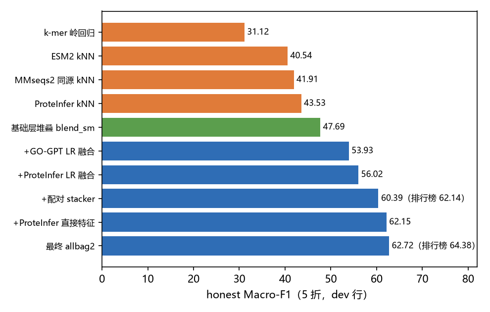
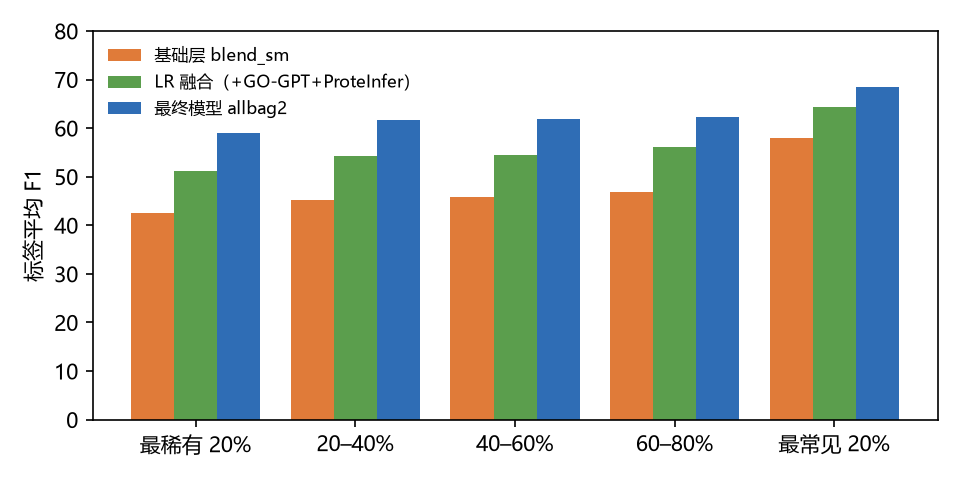
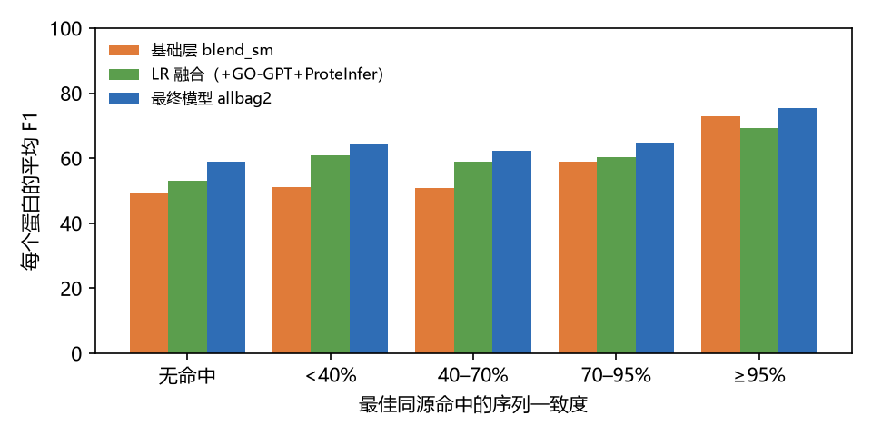

# Model Development and Evaluation

[Report guide](../README.md) · [Figures](../figures.md) · [Tables](../tables.md)

This chapter follows the progression from base predictors through GO-GPT and ProteInfer fusion to the LightGBM protein–label pair stacker, with ablations and subgroup results. Its original final-model figures describe the historical allbag2 variant; the separately confirmed V5 release uses allkbag2 and records a leaderboard score of 64.3818.

Original report section: **7 分析模型的构建与评估**. [Download the source DOCX](https://github.com/Cooljoes/protein-function-prediction-submission/releases/download/v5.0.0/protein_function_prediction_report.docx).

The original report describes the historical `allbag2` workflow. The current [V5.0.0 release](https://github.com/Cooljoes/protein-function-prediction-submission/releases/tag/v5.0.0) uses the separately supplied `allkbag2` CSV, with the owner-confirmed leaderboard score **64.3818**. Original figure labels and table values are retained.

原报告描述历史 `allbag2` 方案；当前 [V5.0.0](https://github.com/Cooljoes/protein-function-prediction-submission/releases/tag/v5.0.0) 使用单独提供的 `allkbag2`，项目所有者确认的排行榜成绩为 **64.3818**。原图标注与表格数值保持原样。

## 7 分析模型的构建与评估

### 7.1 基础模型与基础层

基础模型单独使用时 Macro-F1 在 31–44 之间（表 5）。其中在 ProteInfer 嵌入空间上的 kNN 达到 43.53，是最强的单一模型，说明功能注释预训练得到的表示空间比通用语言模型（40.54）和序列同源（41.91）更贴近 GO 标签。11 个基础模型经 LightGBM 配对堆叠（47.32）与跨标签 MLP 堆叠（45.76）后按 2:1 混合，得到基础层 blend_sm（47.69）。

**表 5  单一模型与基础层的 honest Macro-F1（5 折）**

| 模型 | 信息来源 | honest Macro-F1 |
| --- | --- | --- |
| k-mer 岭回归 | 序列片段 | 31.12 |
| MLP（ESM2 最后层） | 通用语言模型 | 37.79 |
| MLP（ESM2 最后层 + 中间层） | 通用语言模型 | 39.10 |
| 条件 MLP / 边际 MLP | 通用语言模型 + 标签层级 | 39.60 / 39.65 |
| kNN（ESM2） | 通用语言模型 | 40.54 |
| 岭回归头（ProteInfer 嵌入） | 注释预训练模型 | 40.67 |
| MMseqs2 同源 kNN | 同源检索 | 41.91 |
| kNN（GO-GPT 分数空间） | 注释预训练模型 | 43.14 |
| kNN（ProteInfer 嵌入） | 注释预训练模型 | 43.53 |
| LightGBM 配对堆叠 stack_depth | 11 个基础模型 | 47.32 |
| MLP 堆叠 mlpstack | 11 个基础模型 | 45.76 |
| 基础层 blend_sm | 2:1 混合 | 47.69 |

[CSV 下载 / Download CSV](../../data/report-tables/table-05-base-model-results.csv)

### 7.2 引入功能注释预训练模型

GO-GPT 对每个蛋白按 MF / BP / CC 三个方面贪心生成 GO 术语，每个术语的分数取生成过程中出现过的最大 softmax 概率。在每个标签上用逻辑回归融合“基础层 logit + GO-GPT 前 5 个相关术语 + 同源一致度交互 + 生成术语数”，Macro-F1 从 47.69 提升到 53.93（+6.24）。加入 ProteInfer 的 5 个相关 logit 后再提升到 56.02（+2.09）。同源交互项的作用是：GO-GPT 在远缘同源区间增益最大，在一致度 ≥ 95% 时反而略有损害，模型据此学会按同源可信度调节权重。

### 7.3 配对 stacker 与最终模型

逐标签逻辑回归无法看到“这个蛋白整体被预测出多少功能”这类跨标签信息。第三层以“蛋白 × 标签”为样本构建 LightGBM 配对 stacker：以融合 logit 为初始分数，只学习修正量；输入包括 15 个模型的 logit、4 个 ProteInfer 模型的直接 logit、GO-GPT 术语分数、蛋白层面的预测总量与形状、相关标签与父子标签的预测、同源统计等。各项改动的增量见表 6，每一项都经过 dev 与干净行双口径确认。

**表 6  逐步改进的消融结果（dev / 干净行，honest Macro-F1）**

| 版本 | 改动 | dev | 干净行 | 增量 |
| --- | --- | --- | --- | --- |
| blend_sm | 基础层 | 47.69 | 47.59 | — |
| gogptfus_v2_nt_k5 | + GO-GPT 逐标签逻辑回归融合 | 53.93 | 53.83 | +6.24 |
| gogptfus_v2_ntpi_k5 | + ProteInfer（GO 随机划分）logit | 56.02 | 55.94 | +2.09 |
| pairgogpt_v2_pi | + LightGBM 配对 stacker（含标签结构） | 60.39 | 60.32 | +4.37 |
| pid | + ProteInfer logit 直接进入 stacker | 62.10 | 62.05 | +1.71 |
| pid4 | + 全部 4 个 ProteInfer 模型 | 62.15 | 62.10 | +0.05 |
| pid4rs | + 岭回归头 + 蛋白内形状特征 | 62.29 | 62.24 | +0.14 |
| all | + 全部基础模型 + ProteInfer kNN | 62.66 | 62.61 | +0.37 |
| allbag2（最终） | 2 个随机种子平均 | 62.72 | 62.68 | +0.06 |

[CSV 下载 / Download CSV](../../data/report-tables/table-06-model-ablations.csv)

*图 8  模型逐步演进的 honest Macro-F1*

The final model shown here is the report's `allbag2`.

图中的最终模型为报告原始的 `allbag2`。

未被采用的尝试同样提供了信息：EC 随机划分模型加入逻辑回归融合只多 +0.03；GO-GPT 分数空间的 kNN 进入 stacker 仅 +0.04；把训练轮数加倍到 600 轮时 5 折全部提升 +0.14，但未达到预先设定的 +0.15 门槛；预测标签数量、长蛋白第二窗口、GO-GPT v2（信号与 v1 相当而打分需 12 小时）等方向经验证不划算。

### 7.4 模型对比与测试集验证

为检验本地评估是否可信，我们在三个相互独立的口径上对比关键版本，并与排行榜得分对照（表 7）。确认集的 5,000 个蛋白从未参与任何拟合与选择，其分数与 dev 分数相差不超过 0.4；两次提交的排行榜得分与本地分数的差值稳定（排行榜比确认集高约 1.5–1.8），说明本地评估可以可靠地指导模型选择。最终模型的排行榜得分为 64.38，比本地 honest 高 1.66，与提交前按校准关系给出的预估（约 64.5）吻合。

**表 7  关键版本在不同验证口径下的表现**

| 版本 | dev | 干净行 | 确认集 | 排行榜 |
| --- | --- | --- | --- | --- |
| 基础层 blend_sm | 47.69 | 47.59 | 47.52 | — |
| v1：GO-GPT 逐标签融合（3,292 个已打分蛋白训练） | — | — | 53.08 | 54.87 |
| GO-GPT + ProteInfer 逻辑回归融合 | 56.02 | 55.94 | 55.79 | — |
| pairgogpt_v2_pi（配对 stacker） | 60.39 | 60.32 | 60.59 | 62.14 |
| 最终模型 allbag2 | 62.72 | 62.68 | — | 64.38 |

[CSV 下载 / Download CSV](../../data/report-tables/table-07-evaluation-comparison.csv)

最终模型相对上一版的提升（+0.35）在 5 折上全部为正（+0.27～+0.46），500 个标签中有 397 个提升；按同源簇做配对检验，95% 置信区间为 [+0.30, +0.40]，可以排除偶然波动。

### 7.5 分析结果的解释

按标签阳性率分组（图 9），最终模型对各频率段都有大幅提升，最稀有的 20% 标签从 42.6 提升到 59.1（+16.5），提升幅度大于最常见的 20%（58.0→68.5，+10.5），说明注释预训练模型与跨标签结构信息对稀有功能尤其有价值。按同源一致度分组（图 10），无同源命中的蛋白从 49.1 提升到 59.1，远缘同源（&lt;40%）从 51.0 提升到 64.3；逻辑回归融合在一致度 ≥ 95% 时略低于基础层（69.2 对 72.8），而配对 stacker 学会了在这一区间更多依赖同源投票，最终达到 75.5。

*图 9  按标签阳性率分组的平均 F1*

The final model shown here is the report's `allbag2`.

图中的最终模型为报告原始的 `allbag2`。

*图 10  按最佳同源命中一致度分组的每蛋白平均 F1*

The final model shown here is the report's `allbag2`.

图中的最终模型为报告原始的 `allbag2`。

[← Exploratory Data Analysis](06-exploratory-analysis.md) · [Findings, Limitations, and Conclusions →](08-findings-and-conclusions.md)
